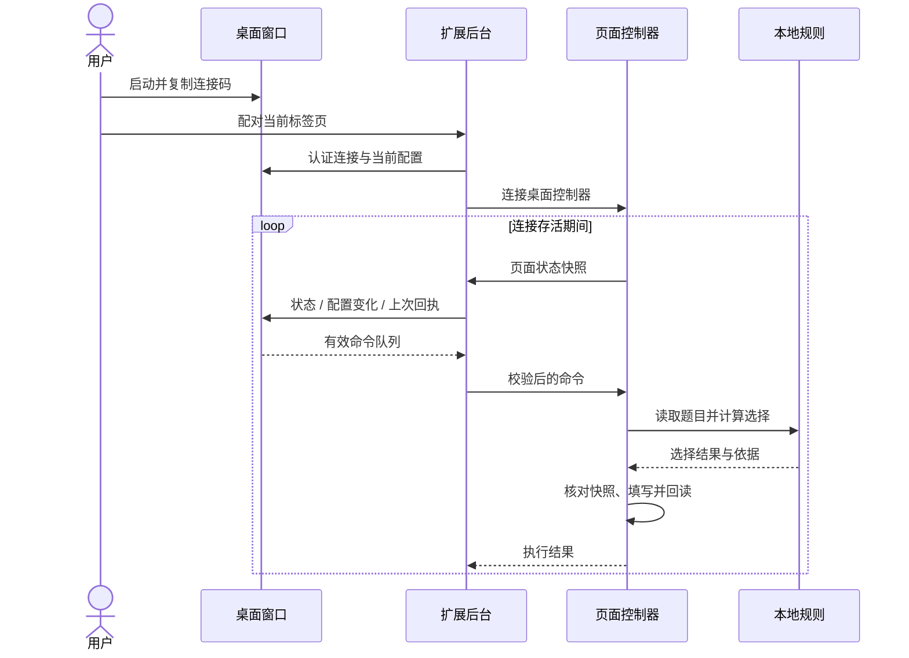

# AutoAssess 架构说明

[返回项目首页](../README.md)

AutoAssess 把可见操作界面与网页执行器分开：Python 桌面程序维护窗口、配置编辑和命令队列；扩展读取当前题目、运行本地规则并核对填写结果。桌面与扩展通过认证的本机 HTTP 通信，题目求解不依赖云端模型。

## 组件

| 组件 | 职责 |
| --- | --- |
| `assessment-plugin/background.js` | 扩展设置、标签页会话、控制器注入、题库与桌面请求路由 |
| `assessment-plugin/content.js` | 当前页面的运行状态机、桌面命令、题目快照和生命周期处理；状态节点不挂载到网页 |
| `assessment-plugin/adapter.js` 及各适配模块 | 题组读取、控件定位、已有作答检查、写入回读与导航 |
| `assessment-plugin/personality.js` | 题型语义检查、量表规则、个人答案、排序、策略与选择依据 |
| `assessment-plugin/desktop-bridge.js` | 配对、心跳、设置同步、命令验证、执行去重与失败清理 |
| `assessment-plugin/desktop-settings.js` | 扩展侧配置白名单与类型、长度校验 |
| `desktop-companion/main.py` | 四页签桌面界面、配置草稿、运行控制、窗口与托盘状态 |
| `desktop-companion/bridge_server.py` | 本机认证服务、单客户端绑定、状态与命令队列 |
| `desktop-companion/settings_model.py` | 桌面侧配置模型、变更版本与编辑状态 |
| `desktop-companion/capture.py` | 当前进程顶层窗口的采集属性设置与回读 |
| `desktop-companion/tray.py` | Windows 通知区域图标、消息线程和恢复入口 |

## 运行流程

连接绑定一个明确的标签页。浏览器当前活动标签的变化不会自动改变绑定目标；配对其他页面须经过显式连接操作。

## 配对与通信边界

桌面服务只监听 `127.0.0.1` 的随机端口，连接码由端口和本次桌面进程的随机令牌组成。数据端点验证 Bearer 令牌、Host 与允许的扩展 Origin，不提供远程监听、文件读写、任意代码或 shell 执行接口。

| 接口 | 作用 |
| --- | --- |
| `GET /health` | 协议版本、能力、连接与窗口属性状态 |
| `POST /connect` | 显式绑定客户端、目标标签及当前配置 |
| `POST /exchange` | 页面快照、配置变化、命令回执与待执行队列 |
| `POST /disconnect` | 释放绑定与队列 |

请求体上限为 512 KiB，配置、快照和命令均有独立的字段与长度校验。配对令牌不会出现在状态响应中。扩展会话存储保存连接信息，桌面内存保存当前快照；题文不进入常规日志。

桌面约 6 秒未收到有效心跳时清除绑定、旧题与待执行命令。扩展发现通信失败时停止对应页面，并清理桌面模式。健康检查的失败处理避免回调尚未初始化完成的内容脚本，以免形成相互等待。

## 命令与运行状态

命令白名单为 `start`、`pause`、`resume`、`stop`、`apply` 和 `configure`。命令带唯一 ID 和到期时间，桌面在确认前可重发；扩展先保存执行标记，再向页面分派。重复命令使用已记录的回执，丢失确认的动作不盲目重放。

页面控制器在异步结果返回和点击前检查运行代次及题目指纹。停止会作废旧结果；暂停保留本次状态与剩余停留时间。配置仅在停止状态保存，成功后清理待用选择，下一次识别使用新配置。

自动填写和“整套问卷已提交”是不同状态。程序只接受可确认的下一题、下一页或题内确认控件；最终提交交给用户。

## 配置的一致性

浏览器扩展存储是已保存配置的来源。桌面维护独立草稿，普通心跳不会覆盖未保存的编辑。

保存流程为：桌面校验 → 排入配置命令 → 扩展白名单与语义校验 → 保存 → 下一次交换回读完整配置与回执。桌面根据确认结果和 `settings_revision` 更新编辑区；连接变更或失效时清除旧绑定的显示状态。

两端共同支持运行方式、停留时间、自动继续、预设、策略、五项倾向、描述排序、个人答案和七项选择器。凭据、外部模型配置和任意执行字段不属于配置模型。

## 题型适配与求解

适配器负责网页结构，规则引擎负责离线选择。支持一个平台名称不等于覆盖该平台的所有控件版本；每种新结构应有对应的最小样例与预期行为。

同页多题在写入前检查已识别题组；已有答案会保留。每次选择后回读控件状态，双角色结果还必须互不相同。页内未答组完成后才能进入导航。

精确答案、已标注量表、完整排序和策略分别报告依据。词组覆盖不足时，部分策略使用明确标注的稳定随机回退；它不计作语义理解或答案准确率。

## Windows 窗口与托盘

窗口采集设置作用于本程序自己的顶层 HWND，通过 `SetWindowDisplayAffinity` 设置后再回读。系统属性匹配与某个捕获工具的实际输出需要分别验证。请求保护却未生效时，开始/填写不可用，已有或待执行的任务会请求停止。

托盘使用标准 `Shell_NotifyIconW`。原生消息在独立线程中转为队列事件，由 Tk 主线程处理窗口恢复、停止与退出。托盘成功后才允许收起窗口；通知区域异常时恢复可访问的入口。图标是否位于折叠区域由 Windows 决定。

## 验证与扩展

从项目根目录运行 `python tools/verify.py`。测试包括离线规则、配置模型、页面控制状态、协议错误处理、真实本机 HTTP 往返及托盘逻辑。构建使用 `python tools/build_release.py`，输出到 `dist/`。

模拟 DOM、模拟 Win32 调用和本机传输测试各自说明不同层面的行为，不能替代真实浏览器、Windows 窗口、托盘或录屏工具的验收。修改页面适配时增加原创结构样例；修改协议时同时验证桌面与扩展的输入边界、回执及断线行为。
